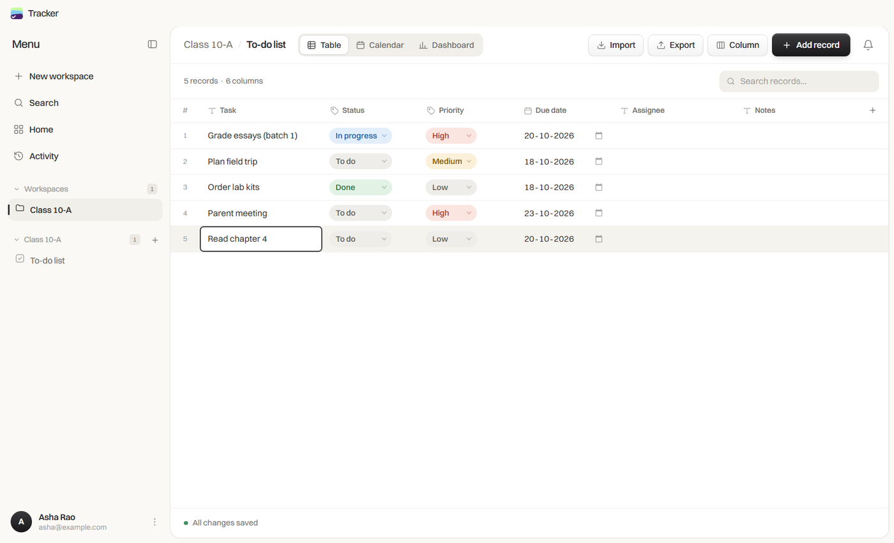
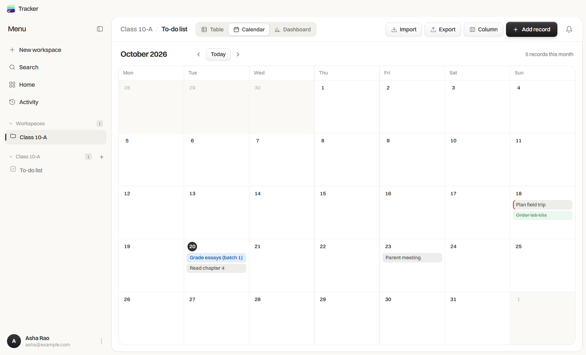
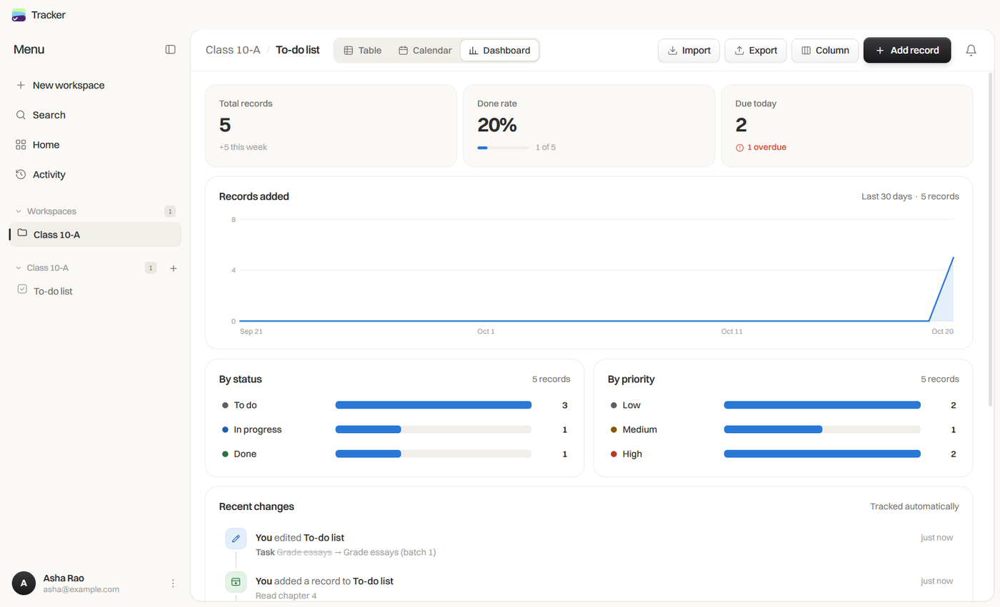
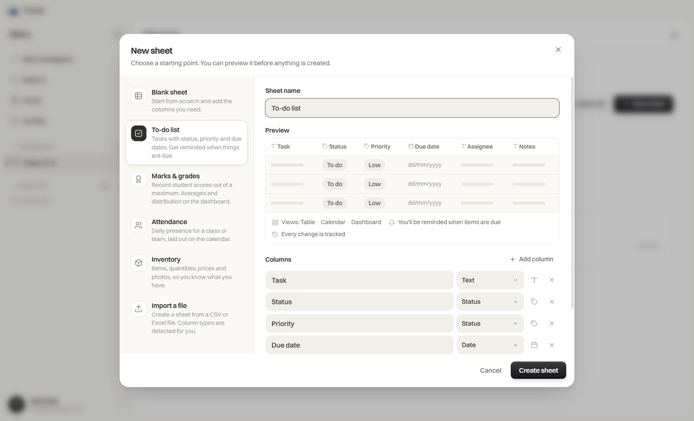
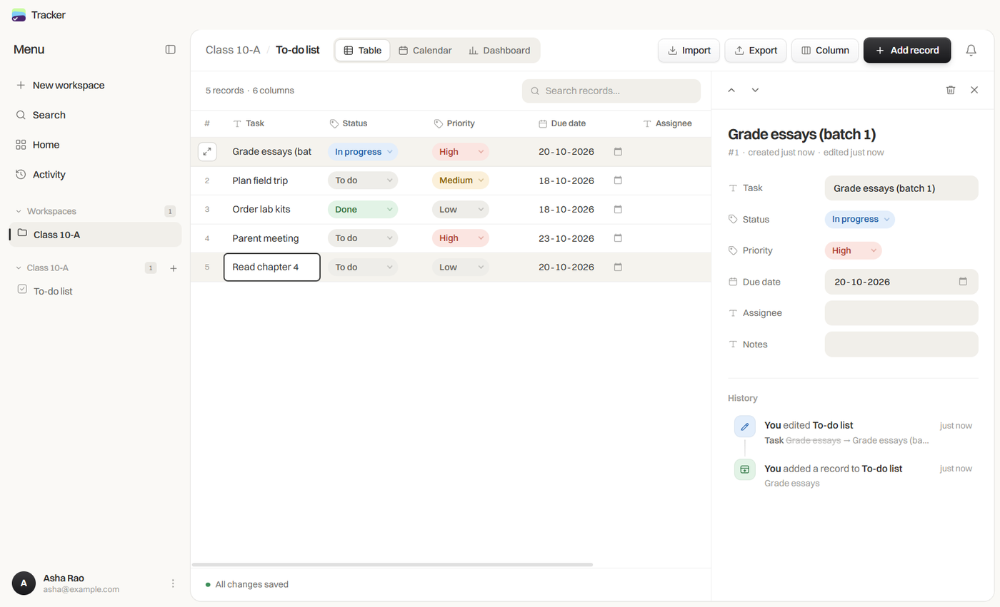
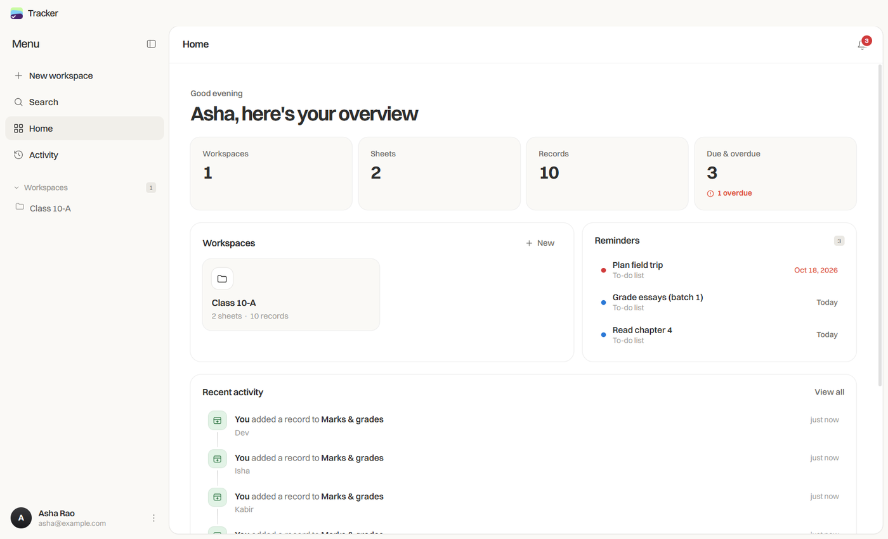
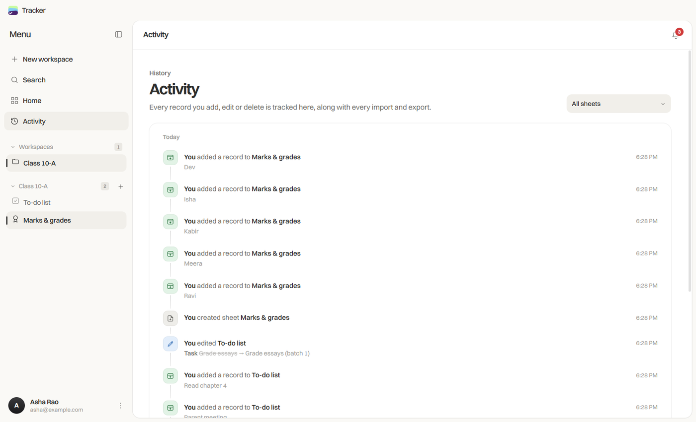
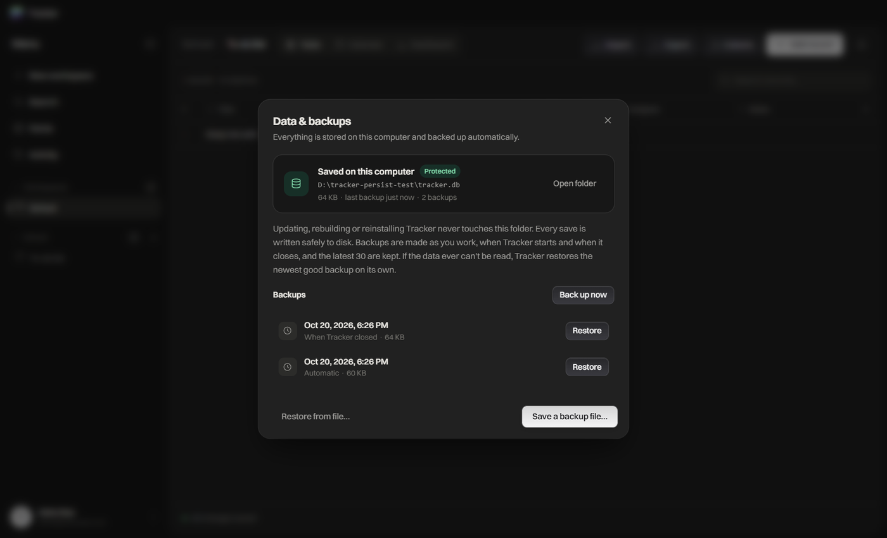
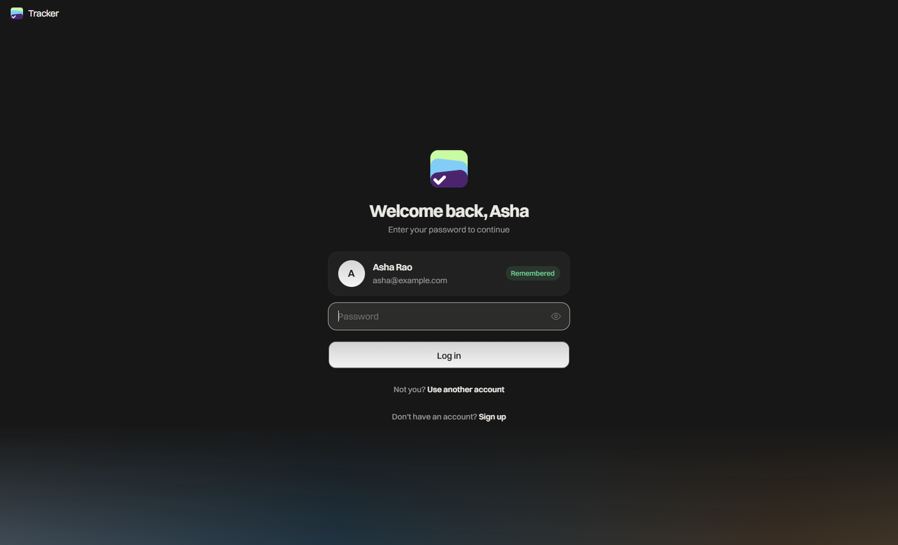

<div align="center">


# Tracker

**Your data, organised your way.**

A private, local-first database app for Windows and macOS.<br>
Build to-do lists, marks registers, attendance sheets, inventories or anything you can describe in columns, then see it as a table, a calendar or a dashboard.

[](https://github.com/pradhan-not-found/Tracker/releases/latest)
[](https://github.com/pradhan-not-found/Tracker/actions/workflows/build.yml)

[](LICENSE)

[**Download for Windows**](https://github.com/pradhan-not-found/Tracker/releases/latest/download/Tracker-windows-x64-setup.exe) &nbsp;·&nbsp;
[**Download for macOS**](https://github.com/pradhan-not-found/Tracker/releases/latest/download/Tracker-macos-arm64.dmg) &nbsp;·&nbsp;
[All downloads](https://github.com/pradhan-not-found/Tracker/releases/latest)

<br>



</div>

<br>

## Contents

- [Why Tracker](#why-tracker)
- [Features](#features)
- [Screenshots](#screenshots)
- [Download and install](#download-and-install)
- [Your data is safe](#your-data-is-safe)
- [Updates](#updates)
- [Accounts and signing in](#accounts-and-signing-in)
- [Keyboard shortcuts](#keyboard-shortcuts)
- [Build from source](#build-from-source)
- [Releasing](#releasing)
- [Landing page](#landing-page)
- [Project structure](#project-structure)
- [Troubleshooting](#troubleshooting)
- [License](#license)

## Why Tracker

- **Private by design.** Everything lives in a SQLite database on your computer. There is no cloud account, no sync service and no telemetry.
- **Works offline.** Nothing needs an internet connection after you install it.
- **Flexible like a spreadsheet, structured like a database.** Typed columns, templates and views instead of loose cells.
- **Starts empty.** No sample data is ever added. What you see is only what you create.

## Features

| | |
|---|---|
| **Workspaces and sheets** | Group related sheets in a workspace, such as a class, a team or a project. |
| **Templates with a live preview** | To-do list, Marks and grades, Attendance, Inventory, Blank sheet, or create a sheet from a CSV or Excel file. You see the result before anything is created. |
| **Typed columns** | Text, Number, Marks (out of a maximum), Date, Checkbox, Status (single choice with colours), File upload, Email and Link. Add, rename, retype or delete columns at any time. |
| **Table view** | A spreadsheet grid with inline editing, sorting, search and a summary row with sums, averages and percentages. |
| **Calendar view** | Records laid out on a month calendar by any date column. Click a day to add a record on that date. |
| **Dashboard view** | Totals, completion rate, due and overdue counts, a 30-day trend, a breakdown per status column and a marks distribution. |
| **Record details** | Open any record in a side panel to edit every field and see its full history. |
| **Everything tracked** | Every record you add, edit or delete, and every column change, import and export, goes into an activity log. |
| **Reminders** | Overdue and due-today items appear in the bell inbox and on Home, with a system notification when you sign in. |
| **Import and export** | Import CSV, XLSX, XLS or ODS with automatic column types. Export a sheet as Excel, CSV or JSON, or a whole workspace as a multi-tab Excel workbook. |
| **Data and backups** | Automatic backups, one-click restore, and backup files you can keep anywhere. See [Your data is safe](#your-data-is-safe). |
| **Design** | Switzer typeface, a calm neutral palette, smooth motion, and light, dark or system themes. |

## Screenshots

<table>
  <tr>
    <td width="50%"><br><sub><b>Calendar</b>: records on their dates, today highlighted.</sub></td>
    <td width="50%"><br><sub><b>Dashboard</b>: totals, completion, trend and breakdowns.</sub></td>
  </tr>
  <tr>
    <td><br><sub><b>Templates</b>: preview the sheet before you create it.</sub></td>
    <td><br><sub><b>Record details</b>: every field plus the change history.</sub></td>
  </tr>
  <tr>
    <td><br><sub><b>Home</b>: workspaces, reminders and recent activity.</sub></td>
    <td><br><sub><b>Activity</b>: a timeline of every change.</sub></td>
  </tr>
  <tr>
    <td><br><sub><b>Data and backups</b>: where your data lives and every backup.</sub></td>
    <td><br><sub><b>Sign in</b>: remembers you and only asks for your password.</sub></td>
  </tr>
</table>

## Download and install

Get the latest version from [**Releases**](https://github.com/pradhan-not-found/Tracker/releases/latest).

| Platform | File | Notes |
|---|---|---|
| Windows 10 / 11 (64-bit) | [`Tracker-windows-x64-setup.exe`](https://github.com/pradhan-not-found/Tracker/releases/latest/download/Tracker-windows-x64-setup.exe) | Installer with Start menu and desktop shortcuts |
| Windows, portable | [`Tracker-windows-x64-portable.exe`](https://github.com/pradhan-not-found/Tracker/releases/latest/download/Tracker-windows-x64-portable.exe) | Runs without installing |
| macOS 12+, Apple Silicon | [`Tracker-macos-arm64.dmg`](https://github.com/pradhan-not-found/Tracker/releases/latest/download/Tracker-macos-arm64.dmg) | M1, M2, M3 and later |
| macOS 12+, Intel | [`Tracker-macos-x64.dmg`](https://github.com/pradhan-not-found/Tracker/releases/latest/download/Tracker-macos-x64.dmg) | Intel Macs |

Each release includes `SHA256SUMS.txt` so you can verify your download.

**First launch.** The builds are not code-signed yet.

- **Windows:** if SmartScreen appears, choose **More info**, then **Run anyway**.
- **macOS:** open the `.dmg`, drag Tracker to Applications, then the first time right-click Tracker and choose **Open**.

## Your data is safe

Tracker treats your data as the most important thing it holds.

- **Stored outside the app.** Your database is kept in your user folder, so updating, rebuilding, reinstalling or uninstalling Tracker never touches it.

  | Platform | Location |
  |---|---|
  | Windows | `%APPDATA%\Tracker\tracker.db` |
  | macOS | `~/Library/Application Support/Tracker/tracker.db` |

- **Crash-safe saving.** Every save is written to a temporary file, flushed to disk and then swapped in atomically, so a crash or power cut can never leave a half-written database.
- **Nothing left unsaved.** Pending changes are written when the window closes, when the computer sleeps or shuts down, and when the app exits.
- **Automatic backups.** Backups are made as you work (at most every 30 minutes after a change), when Tracker starts and when it closes. The latest 30 are kept in the `backups` folder next to your database.
- **Self-healing.** Every time Tracker opens it checks the database. If the file is damaged or missing, Tracker sets the damaged copy aside, restores the newest good backup and tells you.
- **In your control.** **Profile menu → Data & backups** shows where your data lives and every backup. From there you can back up now, restore any backup, save a backup file anywhere (for example a USB drive) or restore from one. Before any restore your current data is backed up first, so a restore can always be undone.

## Updates

Tracker checks for new versions shortly after it starts and a few times a day. When one is out, Tracker shows a message and a small card in the sidebar, and then it **waits for you**. Tracker never sends system notifications; everything appears inside the app. Nothing is downloaded or installed until you choose.

- **Windows installer:** click **Download** and keep working. When it's ready, click **Restart to update**. Your data is saved and backed up before the update installs.
- **macOS and the portable .exe:** click **Download update** to get the new file, then open it. On a Mac, drag the new Tracker into Applications to replace the old one.
- Updates never touch your data. You can also check any time from **Profile menu → Check for updates**.

## Accounts and signing in

- Create a local account with your name, email and password. Passwords are stored as salted SHA-256 hashes, never in plain text.
- **You stay signed in** across restarts and updates until you choose **Sign out**. The session is kept in the database itself.
- After signing out, the sign-in screen remembers you: it greets you by name with your photo and only asks for your password. **Use another account** switches to a different person.
- Each account sees only its own workspaces.

## Keyboard shortcuts

| Shortcut | Action |
|---|---|
| <kbd>Ctrl</kbd>/<kbd>⌘</kbd> + <kbd>K</kbd> | Search the sidebar |
| <kbd>Ctrl</kbd>/<kbd>⌘</kbd> + <kbd>N</kbd> | Add a record to the open sheet |
| <kbd>Enter</kbd> | In the table, save and move to the same column on the next row |
| <kbd>Ctrl</kbd>/<kbd>⌘</kbd> + <kbd>Enter</kbd> | Confirm the open dialog |
| <kbd>Esc</kbd> | Close a menu, dialog or record panel |

## Build from source

**Requirements:** Node.js 22 or later.

```bash
git clone https://github.com/pradhan-not-found/Tracker.git
cd Tracker
npm install
npm start          # run the app
npm run dev        # run with DevTools
```

Build installers:

```bash
npm run build:win   # dist/Tracker-windows-x64-setup.exe and the portable .exe
npm run build:mac   # dist/Tracker-macos-arm64.dmg and Tracker-macos-x64.dmg (run on a Mac)
```

Development and testing never touch your real data if you point Tracker at another folder:

```bash
TRACKER_USER_DATA=/path/to/test-folder npm start
```

## Releasing

[`build.yml`](.github/workflows/build.yml) builds and tests the Windows and macOS packages on every push to `main`. [`release.yml`](.github/workflows/release.yml) runs only for version tags: it reuses the same build and tests, then publishes the release. To publish one:

1. Bump `version` in `package.json` (and `VERSION` in `landing/lib/downloads.ts`), and add the release notes to `ui/js/changelog.js`. They appear in the app's "What's new" and become the GitHub release notes.
2. Commit, then push a matching tag:

   ```bash
   git tag v2.4.4
   git push origin v2.4.4
   ```

The workflow checks that the tag matches the app version, builds every platform and publishes a GitHub Release with the installers and `SHA256SUMS.txt`. File names carry no version, so `releases/latest/download/...` links always point at the newest build.

## Landing page

`landing/` is a Next.js site with download buttons for Windows and macOS and a live in-browser demo.

```bash
cd landing
npm install
npm run dev        # http://localhost:3000
npm run build      # static export in landing/out
```

**Deploy on Vercel:** import this repository, set **Root Directory** to `landing` and deploy. Next.js is detected automatically. Set `NEXT_PUBLIC_SITE_URL` if you use a custom domain. [`landing.yml`](.github/workflows/landing.yml) checks on every push that the site builds.

## Project structure

```
electron/          Desktop shell (window, storage, updates)
  main.js            window, menus, IPC
  storage.js         durable SQLite storage, integrity checks, backups
  preload.js         safe bridge exposed to the UI
ui/                The app interface (HTML, CSS and plain JavaScript)
  js/core.js         bridge, SQL helpers, motion, toasts, dialogs
  js/schema.js       tables, column types, templates, settings
  js/auth.js         accounts, sessions, profile
  js/activity.js     activity log and reminders
  js/table.js        table view, cell editors, column editor, record panel
  js/views.js        calendar and dashboard
  js/io.js           new-sheet wizard, import and export
  js/data.js         data and backups panel
  js/app.js          navigation, home and workspace views
landing/           Next.js landing page
assets/            App icons for every platform
docs/screenshots/  Images used in this README
src/main.swift     Optional native macOS shell (WKWebView), built with build_dmg.sh
```

**Built with** [sql.js](https://sql.js.org/) (SQLite), [SheetJS](https://sheetjs.com/) for spreadsheets, [GSAP](https://gsap.com/) for motion, the [Switzer](https://www.fontshare.com/fonts/switzer) typeface, and [Next.js](https://nextjs.org/) for the landing page.

## Troubleshooting

<details>
<summary><b>The app starts without a window when run from VS Code's terminal</b></summary>

VS Code's terminal sets an environment variable that makes the desktop runtime start in command-line mode. Clear it before `npm start`: run `set ELECTRON_RUN_AS_NODE=` on Windows or `unset ELECTRON_RUN_AS_NODE` on macOS.
</details>

<details>
<summary><b>I want to move my data to another computer</b></summary>

Open **Profile menu → Data & backups → Save a backup file…**, copy the file to the other computer, install Tracker there and use **Restore from file…**.
</details>

<details>
<summary><b>Where are the backups?</b></summary>

In the `backups` folder next to `tracker.db` (see [the locations above](#your-data-is-safe)), or open **Data & backups → Open folder**.
</details>

## License

[MIT](LICENSE)
